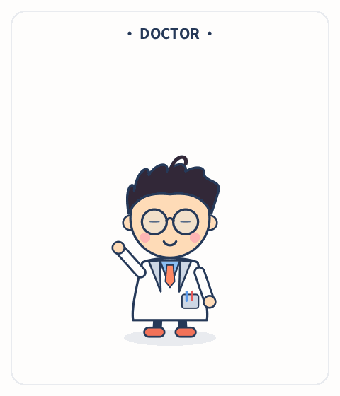
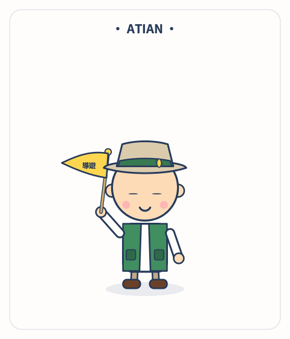
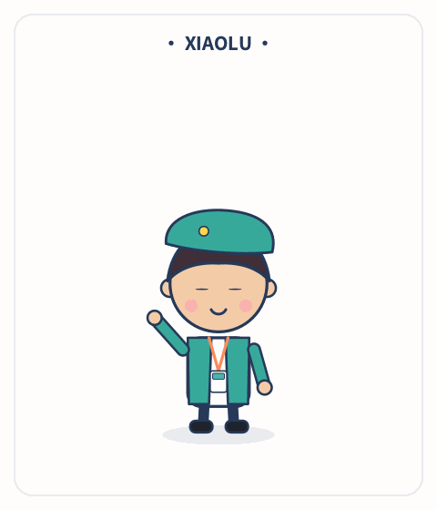
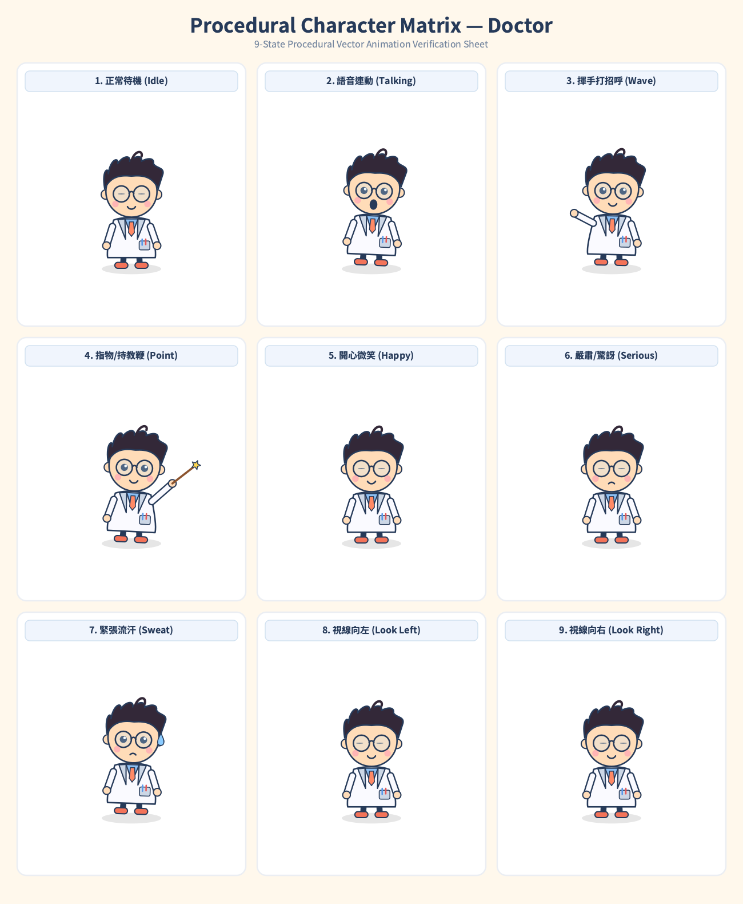

# Procedural Vector Cartoon Character Craft
### 純程式化向量卡通角色設計與動態生成套件

[](https://www.python.org/)
[](https://pycairo.readthedocs.io/)
[](LICENSE)
[](#)

一套 **100% 純程式碼、零外部素材依賴（零失真純向量）** 的 2D 卡通角色設計與動畫管線。適用於科普影片解說員、教學導覽吉祥物、網頁即時互動角色與 YouTube / Reels 卡通動畫。

---

## 🌟 內建經典角色展示 (Character Showcase)

| **AI 小博士 (Doctor)** | **在地導遊・阿天 (A-Tian)** | **智慧大使・小綠 (Xiaolu)** |
| :---: | :---: | :---: |
|  |  |  |
| 白色實驗袍、圓眼鏡、橘領帶、口袋筆、星光木質教鞭、天線呆毛 | 卡其遮陽帽、竹葉徽章、綠色登山背心、飄揚導遊旗、短靴 | 湖水綠貝雷帽、夾克套裝、橘色掛繩識別牌、雷射簡報筆 |

---

## 🎨 九宮格動作與表情驗證矩陣 (9-State Verification Matrix)

每位角色皆經過 9 種標準狀態的嚴格圖層與動畫驗證：

<p align="center">
  
</p>

1. **正常待機 (Idle)**：正弦波呼吸起伏與微晃動態。
2. **語音連動 (Talking)**：嘴巴開闔高度隨 TTS 語音振幅（RMS）連續即時連動。
3. **揮手打招呼 (Wave)**：橡皮管手臂以 9 rad/s 節奏有精神地揮動或搖旗。
4. **指物導引 (Point)**：手持教鞭/導引筆指向目標，末端伴隨星光自旋閃爍。
5. **開心微笑 (Happy)**：閉嘴狀態呈現親切圓弧微笑唇。
6. **嚴肅/驚訝 (Serious)**：閉嘴狀態呈現微凹唇形。
7. **緊張冒汗 (Sweat)**：動態汗滴沿臉頰向下滑落循環。
8. **視線向左 (Look Left)**：眼珠與眼神高光平移。
9. **視線向右 (Look Right)**：眼珠與眼神高光平移。

---

## 🚀 快速上手 (Quick Start)

### 1. 安裝環境依賴

```bash
# macOS 系統依賴
brew install cairo pkg-config

# Python 依賴庫
pip install -r requirements.txt
```

### 2. 測試與生成角色預覽

```bash
# 輸出 9 格狀態檢驗表
python tools/preview_grid.py doctor assets/matrix_doctor.png

# 算繪 3 秒平滑循環動態 GIF (24 FPS)
python tools/render_demo_gif.py doctor assets/demo_doctor.gif
```

### 3. 開啟網頁版即時互動調試器 (Web Playground)

直接用瀏覽器開啟 `web/index.html`，即可透過視覺化拉桿即時微調 `mouth`（嘴巴開闔）、`look`（視線角度）、開關各項動作，並可在 60 FPS 下即時觀察向量畫質！

```bash
open web/index.html
```

---

## 📐 十二層人體解剖學圖層順序

為了避免角色呼吸起伏或做動作時發生穿幫，嚴格遵循「由底至頂」的圖層架構：

```
[12. 特效層]  汗滴 (sweat)、星光特效 (stars)
      ↑
[11. 嘴型層]  語音 RMS 音量連動嘴型 (mouth) 或表情弧線 (happy)
      ↑
[10. 配飾層]  眼鏡 (glasses)、識別牌、領帶、胸前口袋筆
      ↑
[09. 頭飾層]  遮陽帽、貝雷帽、耳機、安全帽
      ↑
[08. 臉部五官] 雙頰腮紅、眼睛自然眨眼與視線偏移 (look)
      ↑
[07. 髮型層]  瀏海短髮、天線呆毛
      ↑
[06. 頭部基底] 雙耳 (ears)、臉頰膚色底色
      ↑
[05. 手臂肢體] 橡皮管手臂：揮手 (wave) / 持教鞭 (point) / 自然垂放
      ↑
[04. 軀幹外著] 實驗袍、背心、外套夾克
      ↑
[03. 軀幹內著] 襯衫、T-shirt
      ↑
[02. 下身雙腿] 褲管、皮鞋/登山短靴
      ↑
[01. 投影基底] 腳底橢圓形半透明黑陰影 (0.10 alpha)
```

詳細解說請參閱 [references/anatomy-and-layers.md](references/anatomy-and-layers.md)。

---

## 🧮 動畫核心數學公式

* **自然呼吸與點頭 (Breathing)**：
  ```python
  bob = -abs(math.sin(t * 4.2)) * 12
  ctx.translate(0, bob + 200)
  ctx.rotate(math.sin(t * 2.1) * 0.05)
  ctx.translate(0, -200)
  ```
* **自然眨眼週期 (Blinking Modulo)**：
  ```python
  blink = (t % 3.1) < 0.13
  ctx.scale(1.0, 0.12 if blink else 1.0)
  ```
* **語音音量開嘴連動 (Mouth Volume Sync)**：
  ```python
  if mouth > 0.08:
      ctx.scale(1.0, (4 + 18 * mouth) / 13)
      ctx.arc(0, 0, 13, 0, 2 * math.pi)
  ```

詳細數學請參閱 [references/animation-math.md](references/animation-math.md)。

---

## 🔄 全域角色無縫熱插拔 (Monkey-Patching)

在影片生成專案中，無需修改任何場景代碼，一秒切換整部影片的主持人：

```python
# 模組底部自動置換
import dc
from characters.doctor import doctor

dc.doctor = doctor  # 全域所有場景自動更新為新角色！
```

---

## 📄 授權條款 (License)

本專案採用 [MIT License](LICENSE) 授權開源。
